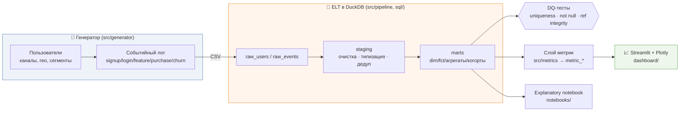
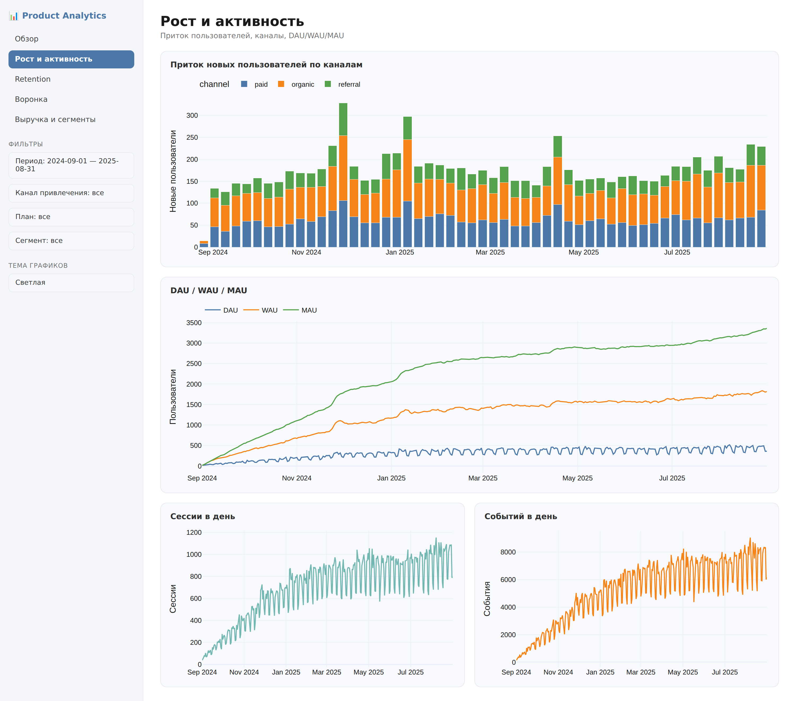
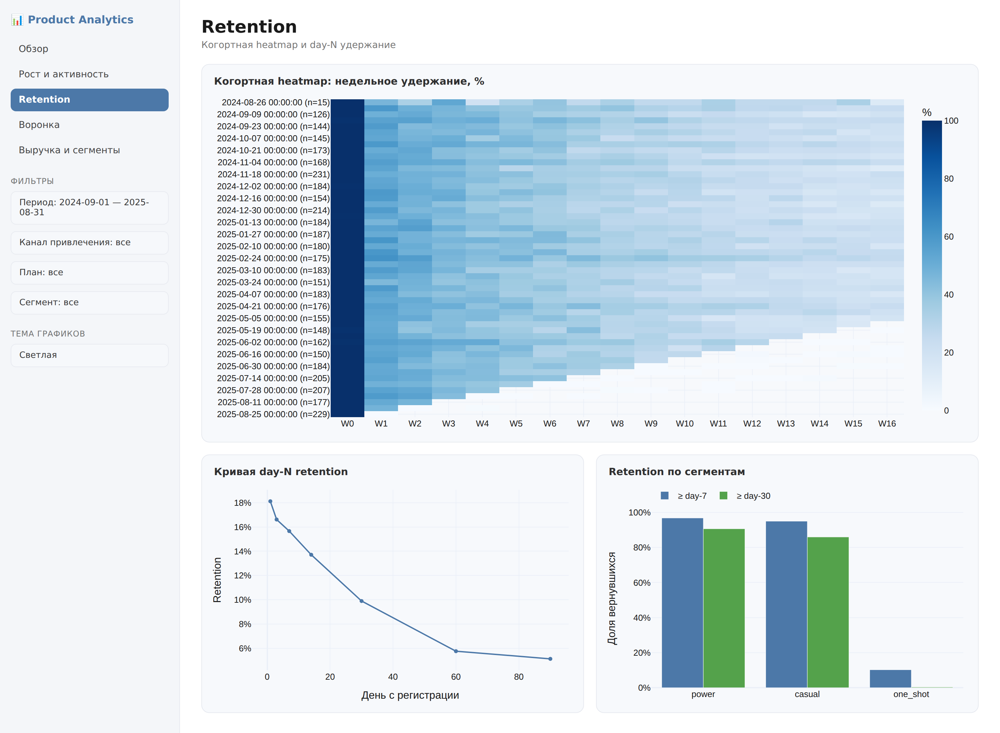
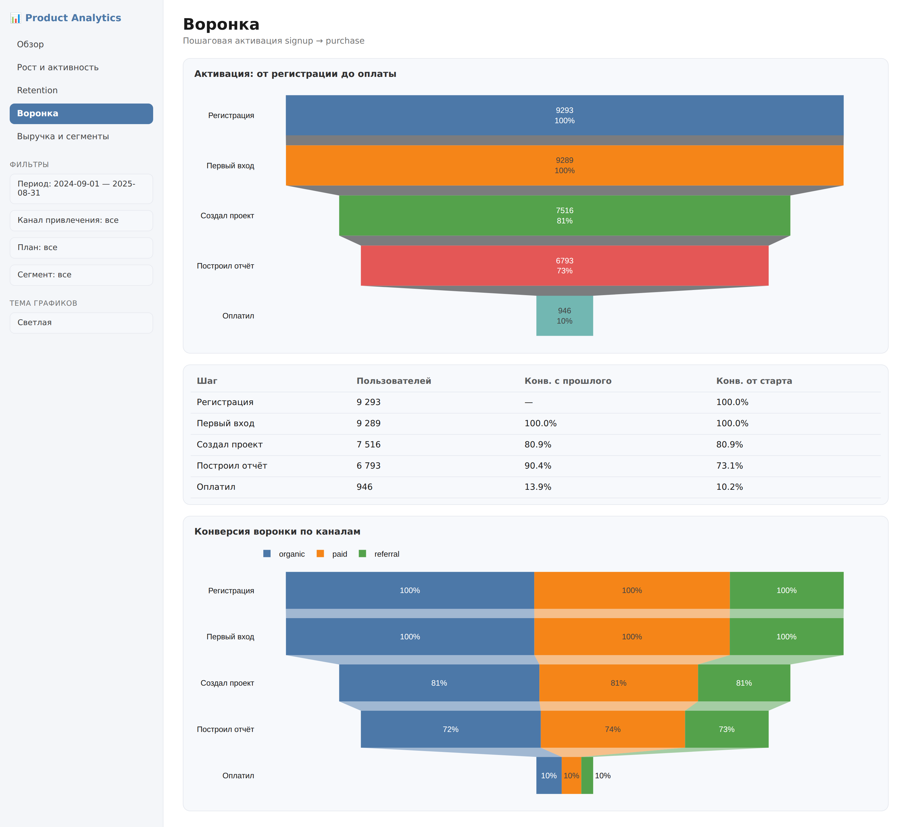
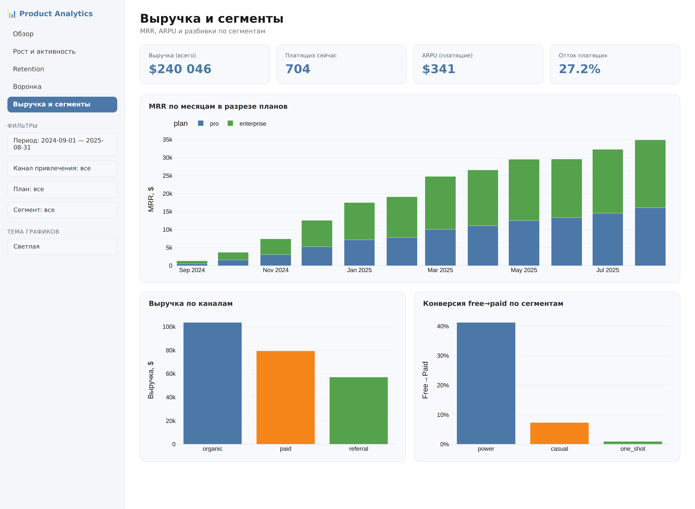
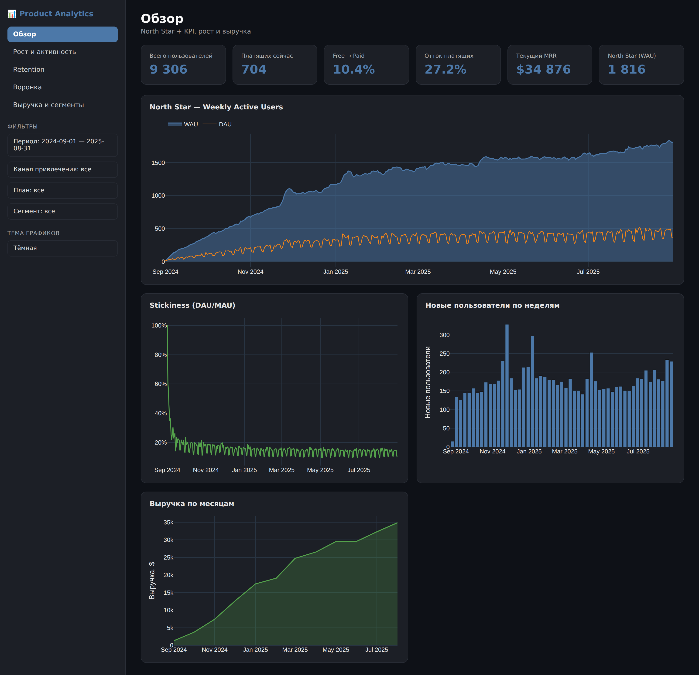

# 📊 Product Analytics Platform — мини-«Amplitude» своими руками

> End-to-end продуктовая аналитическая платформа для SaaS/мобильного приложения:
> **генерация реалистичных событий → ELT-пайплайн на DuckDB → слой продуктовых
> метрик → интерактивный Streamlit-дашборд.** Всё воспроизводится одной командой.

<p>
  
  
  
  
  
</p>


---

## Мотивация

Продуктовому аналитику важно уметь пройти весь путь данных: от сырых событий до
метрик, на которые смотрит менеджмент. Готовые сервисы (Amplitude, Mixpanel)
прячут эту «кухню». Этот проект её раскрывает — воспроизводит мини-Amplitude на
открытом стеке, чтобы показать владение **моделированием данных, ELT, SQL,
продуктовыми метриками и визуализацией** в одном месте.

Что демонстрирует проект:

- реалистичное моделирование поведения пользователей (когорты, удержание,
  монетизация, «грязные» данные);
- слоистую архитектуру данных `raw → staging → marts` в стиле dbt;
- расчёт и корректные **определения** ключевых продуктовых метрик;
- продуктовый дашборд с фильтрами, пригодный для стейкхолдеров;
- инженерную культуру: тесты, линтинг, CI, воспроизводимость.

---

## Архитектура



**Слои данных:**

| Слой | Что делает | Модели |
|------|------------|--------|
| `raw` | загрузка сырых CSV «как есть» | `raw_users`, `raw_events` |
| `staging` | очистка, типизация, дедупликация, удаление грязи | `stg_users`, `stg_events` |
| `marts` | аналитические витрины | `dim_users`, `dim_dates`, `fct_events`, `fct_sessions`, `agg_daily_activity`, `cohort_retention` |
| `metrics` | продуктовые метрики поверх витрин | `metric_active_users`, `metric_retention_dayn`, `metric_activation_funnel`, `metric_mrr`, `metric_segments`, `metric_summary` |

Пайплайн исполняет **собственный мини dbt-раннер** (`src/pipeline/runner.py`):
модели — обычные `.sql` файлы с `{{ ref() }}` / `{{ source() }}`, зависимости
разрешаются топологической сортировкой, после сборки прогоняются data-quality
тесты из `sql/tests/`.

---

## Скриншоты

| Рост и активность | Retention (когортная heatmap) |
|---|---|
|  |  |

| Воронка активации | Выручка и сегменты |
|---|---|
|  |  |

Дашборд поддерживает светлую и тёмную тему:

| Светлая | Тёмная |
|---|---|
|  |  |

---

## Стек

- **Python 3.11+**, `pandas` / `numpy` — генерация и обработка данных;
- **DuckDB** — аналитическая БД и движок SQL-моделей;
- **SQL (dbt-style)** — слоистые модели с `ref()`/`source()` и DQ-тестами;
- **Streamlit + Plotly** — многостраничный интерактивный дашборд;
- **pytest** — тесты генератора, пайплайна и метрик;
- **ruff + black** — линтинг и форматирование;
- **pre-commit + GitHub Actions** — контроль качества и CI.

---

## 🚀 Quickstart

```bash
# 1. Клонировать
git clone https://github.com/<your-username>/product-analytics-platform.git
cd product-analytics-platform

# 2. (опционально) виртуальное окружение
python3 -m venv .venv && source .venv/bin/activate

# 3. Установить зависимости и хуки
make setup

# 4. Всё одной командой: данные → витрины → метрики → дашборд
make all
```

`make all` сгенерирует ~12 месяцев событий, соберёт витрины в DuckDB, посчитает
метрики и поднимет дашборд на <http://localhost:8501>.

Отдельные шаги:

```bash
make generate-data   # синтетика -> data/raw
make build           # raw -> staging -> marts (+ DQ-тесты)
make metrics         # слой метрик metric_*
make pipeline        # generate-data + build + metrics
make dashboard       # только дашборд (данные уже собраны)
make test            # pytest
make lint            # ruff + black --check
make clean           # удалить данные и кэши
```

Параметры генерации (число пользователей, период, seed, сезонность,
маркетинговые всплески, «грязь») задаются в **`config/config.yaml`**.

---

## Структура проекта

```
product-analytics-platform/
├── config/config.yaml          # все параметры генерации и пайплайна
├── src/
│   ├── config.py               # типизированная загрузка конфига
│   ├── generator/generate.py   # ⭐ генератор синтетических событий
│   ├── pipeline/
│   │   ├── load.py             # загрузка сырых CSV в DuckDB
│   │   └── runner.py           # мини dbt-раннер + DQ-тесты
│   └── metrics/metrics.py      # слой продуктовых метрик
├── sql/
│   ├── staging/                # очистка и типизация
│   ├── marts/                  # dim / fct / агрегаты / когорты
│   └── tests/                  # data-quality тесты
├── dashboard/
│   ├── app.py                  # страница «Обзор»
│   ├── lib.py                  # доступ к данным, фильтры, тема
│   └── pages/                  # рост, retention, воронка, выручка
├── tests/                      # pytest: генератор, пайплайн, метрики
├── notebooks/analysis.ipynb    # разбор «для стейкхолдеров»
├── docs/screenshots/           # скриншоты дашборда
├── Makefile  METRICS.md  README.md  LICENSE
├── pyproject.toml  requirements.txt  .pre-commit-config.yaml
└── .github/workflows/ci.yml    # lint + tests
```

---

## Что моделирует генератор

Ядро проекта — генератор в `src/generator/generate.py`. Он воспроизводит:

- **приток пользователей** с трендом роста, недельной и годовой сезонностью и
  маркетинговыми всплесками (Black Friday и т.п.);
- **поведенческие сегменты** (power / casual / one_shot) со своей вероятностью
  удержания и конверсии;
- **затухающее удержание** — вероятность вернуться падает по экспоненте с
  момента регистрации (halflife зависит от сегмента);
- **сессии** — login + последовательность feature-событий с корректными
  таймстемпами внутри сессии;
- **монетизацию** — конверсию free→paid, помесячные списания (MRR) и отток
  платящих;
- **«грязь» в данных** — дубликаты строк и событий, пропуски в гео/устройстве,
  редкие таймстемпы «из будущего», аномальные суммы покупок, боты-выбросы.

Всё детерминировано относительно `seed` — данные полностью воспроизводимы.

---

## Метрики

Полные определения каждой метрики (формула, источник, нюансы) — в
**[METRICS.md](METRICS.md)**. Кратко:

- **Активность:** DAU / WAU / MAU и **stickiness** (DAU/MAU);
- **Удержание:** day-N retention и weekly-cohort retention (heatmap);
- **Отток:** paid churn rate;
- **Монетизация:** free→paid конверсия, **MRR** по планам, ARPU;
- **Воронка активации:** строго вложенная `signup → … → purchase`;
- **Сегменты:** разбивки по каналу, плану и гео.

North Star метрика проекта — **WAU** (недельная активная аудитория).

---

## Ключевые выводы (на синтетических данных)

1. **Рост здоровый:** WAU/MAU растут весь год, видны недельная сезонность и
   отклик на маркетинговые кампании.
2. **Retention — главная точка роста:** основная просадка на первой неделе →
   приоритет на онбординг и активацию первого дня.
3. **Монетизация упирается в шаг оплаты:** продуктовую воронку проходят почти
   все, но конверсия в покупку низкая.
4. **Сегменты сильно различаются:** power-пользователи удерживаются и платят
   кратно лучше — их выгодно растить.

Подробный разбор с графиками — в `notebooks/analysis.ipynb`.

---

## Возможные улучшения

- полноценный **dbt-core** вместо самописного раннера + `dbt docs`;
- инкрементальные модели и партиционирование для больших объёмов;
- прогноз MRR и **LTV/CAC** по каналам, анализ платёжных когорт;
- фреймворк A/B-тестов и sequential-тестирование;
- оркестрация (Airflow/Dagster/Prefect) и загрузка в облачный DWH
  (BigQuery/Snowflake);
- экспорт метрик в BI (Metabase/Superset) и алерты на аномалии.

---

## Лицензия

[MIT](LICENSE) © Fedor Bogomolov
