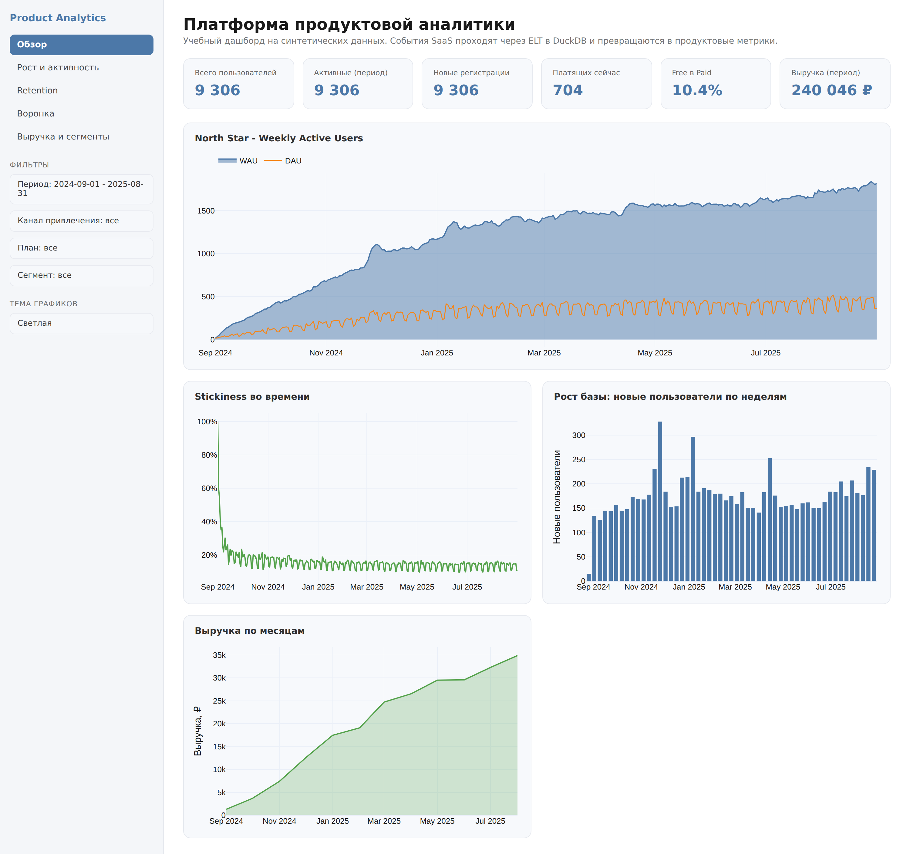
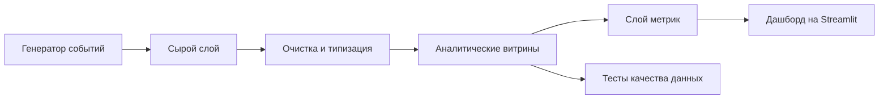

# Product Analytics Platform

Полноценная система продуктовой аналитики, собранная с нуля. Проект генерирует реалистичные события SaaS продукта, прогоняет их через пайплайн обработки на DuckDB, считает продуктовые метрики и показывает всё в интерактивном дашборде.




## Как это работает



Сначала сырые события попадают в базу как есть. Потом слой очистки убирает дубликаты, приводит типы и выкидывает мусор из данных. Дальше собираются аналитические витрины, а поверх них считаются метрики, которые забираются в дашборд.

| Слой | Что делает |
|------|------------|
| raw | загрузка сырых событий без изменений |
| staging | очистка, типизация, удаление дубликатов и аномалий |
| marts | витрины пользователей, событий, сессий, когорт и дневной активности |
| metrics | расчёт продуктовых метрик поверх витрин |

## Стек

Python и pandas для генерации данных. DuckDB как аналитическая база и движок SQL. SQL в стиле dbt для слоёв и витрин. Streamlit и Plotly для дашборда. pytest для тестов, ruff и black для линтинга и форматирования. pre-commit и GitHub Actions для контроля качества.

## Как запустить

```bash
git clone https://github.com/<ваш-логин>/product-analytics-platform.git
cd product-analytics-platform

make setup   # установка зависимостей
make all     # данные, витрины, метрики и запуск дашборда
```

После запуска дашборд открывается на localhost:8501. Отдельные шаги тоже доступны через make, это generate-data, build, metrics, test, lint и dashboard. Все параметры генерации, такие как число пользователей, период и random seed, задаются в файле config/config.yaml.

## Что внутри

```
config/      параметры генерации и пайплайна
src/         генератор, пайплайн и слой метрик
sql/         SQL модели по слоям и тесты качества данных
dashboard/   многостраничный дашборд на Streamlit
tests/       тесты генератора, пайплайна и метрик
notebooks/   разбор данных с выводами для бизнеса
docs/        скриншоты и инструкция по заливке на GitHub
```

## Для чего этот проект

В процессе работы над проектом я научился проектировать хранилище по слоям и прорабатывать логику трансформаций в SQL в виде единого пайплайна обработки данных. Также было подготовлено много сложных аналитических SQL запросов под продуктовые задачи. Упор делал именно на использование SQL в бою, чтобы разобраться, как это работает в аналитических платформах по типу Amplitude и т.д. Далее поработал с метриками, собрал дашборд, который перестраивается под поставленные фильтры и покрыл весь проект тестами и линтерами.

